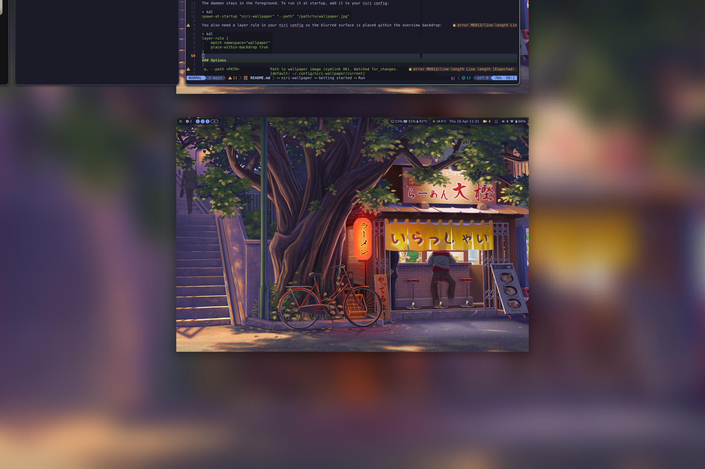

# niri-wallpaper



A lightweight, single-process wallpaper daemon for [niri](https://github.com/YaLTeR/niri).

It manages two layer-shell surfaces per output:

- **`wallpaper-bg`** -- the regular desktop background
- **`wallpaper`** -- a pre-blurred copy shown as the overview backdrop (via niri's `place-within-backdrop` layer rule)

Both surfaces live in one process, so there is no extra compositor round-trip or GPU context. The blur is computed once on the CPU when the wallpaper changes, and the daemon is fully idle the rest of the time.

> **Note:** This project was largely built with AI assistance.
> It exists to scratch a personal itch -- a niri-specific wallpaper setup that is simple and lightweight.
> I don't plan to actively maintain it beyond my own needs.

## Features

- Dual-layer output: normal background + blurred overview backdrop
- Hot-reload: watches the wallpaper path (symlink or file) via inotify and redraws on change
- SIMD-accelerated cover-scale resize (via `fast_image_resize`)
- Configurable blur (downsample, radius, iterations)
- Multi-output aware
- Minimal RSS footprint (`malloc_trim` after decode/resize cycles)

## Getting started

### Build

```sh
cargo build --release
```

The binary is at `target/release/niri-wallpaper`.

### Run

```sh
# Use the default path (~/.config/niri-wallpaper/current)
niri-wallpaper

# Or point to a specific image
niri-wallpaper --path /path/to/wallpaper.jpg
```

The daemon stays in the foreground. To run it at startup, add it to your niri config:

```kdl
spawn-at-startup "niri-wallpaper" "--path" "/path/to/wallpaper.jpg"
```

You also need a layer rule in your niri config so the blurred surface is placed within the overview backdrop:

```kdl
layer-rule {
    match namespace="wallpaper"
    place-within-backdrop true
}
```

### Options

```
-p, --path <PATH>              Path to wallpaper image (symlink OK). Watched for changes.
                               [default: ~/.config/niri-wallpaper/current]
--blur-downsample <N>          Downsample factor before blurring (higher = softer + faster). [default: 8]
--blur-radius <N>              Box-blur radius in downsampled pixels. [default: 6]
--blur-iterations <N>          Box-blur passes (3 ≈ Gaussian). [default: 3]
--normal-namespace <NAME>      Layer-shell namespace for the normal surface. [default: wallpaper-bg]
--backdrop-namespace <NAME>    Layer-shell namespace for the backdrop surface. [default: wallpaper]
-h, --help                     Print help.
```

Supported image formats: JPEG, PNG, WebP.

## License

MIT
